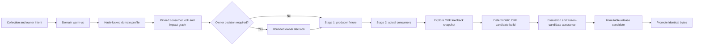

# OKF Foundry prompt kit

New producers use the v2 handoff for core OKF 0.3. Historical
[v1/core 0.2 handoffs](../profiles/authoring/v1/) remain valid under their own
schema. The checker dispatches by declared handoff version. Follow the
[per-bundle acceptance contract](okf-0.3-estate-acceptance.md) and provide a
separate source-linked visual question, worked answer and consumer evidence
for every actual bundle. Neither a scaffold nor a catalogue entry proves
source, consumer or release acceptance.

For a personal first experiment, use [the complete small starter](onboarding/first-bundle.md). This prompt kit is the governed production route; its profiles and release gates remain required when applicable.


Anyone responsible for a collection of documents or records can use this kit
to turn it into an evidence-bearing OKF publication. It transfers the reusable
method developed across legislation, ONS data discovery, GOV.UK content,
government APIs, CKAN and the OKF Explorer without transferring their domain
assumptions or their very large working transcripts.

## Use the two-stage prompt workflow

1. [Compile the domain profile](prompts/okf-domain-warm-up.md). This read-only
   warm-up researches the collection, people/tasks, terminology, authority,
   rights, identifiers, versions, relationships, applicable standards and the
   actual software consumers that must read or publish the result.
2. Review any genuinely blocking owner decisions and approve the checksummed
   `okf-domain-profile.v2` handoff plus its pinned consumer lock and explicit
   dependency/impact graph.
3. [Build, validate and publish](prompts/okf-bundle-build.md). The builder
   consumes that exact handoff, implements the smallest justified bundle and,
   when selected, creates a bounded Explore OKF snapshot for feedback before
   release-candidate construction.

For an empty or imported target, begin the build with the fail-safe repository
bootstrap:

```sh
uv run --locked python scripts/okf_repository_bootstrap.py /path/to/target
uv run --locked python scripts/okf_repository_bootstrap.py /path/to/target --apply
uv run --locked python scripts/okf_repository_bootstrap.py /path/to/target --check --adopt-existing
```

The first command is a dry run. Adoption is always explicit. The scaffolder
does not initialise Git, create a remote, commit, enable CI, push or publish.

Use `--kind general` for general repository foundations when an OKF purpose
has yet to be agreed. Follow the [repository creation and discovery
conventions](repository-conventions.md), verify the initial default branch and
commit after an authorised push, and repeat discovery with index inspection.

The handoff is validated by the
[`okf-domain-profile.v2` schema](../profiles/authoring/v2/domain-profile.schema.json).
Start from the complete
[YAML template](../profiles/authoring/v2/domain-profile.template.yaml).



The profile—not the chat history—is the durable interface between research and
implementation.

## Use this with a capable AI

The workflow is product-neutral. Use an AI that can inspect the supplied
collection and create the required files. The build stage additionally needs
permission to write to the target repository, run its validators and publish
only when publication is authorised. A chat-only AI can prepare a handoff; it
must not claim that it built, tested or published a bundle.

1. Record the collection location, intended outcome, users/tasks, operating
   context, repository or publication target, research cut-off, access policy,
   known owner decisions and bounded budget. Never put secrets in a prompt.
2. Open the [formatted domain warm-up](prompts/okf-domain-warm-up.md), select
   **Copy full prompt**, replace every `{{PLACEHOLDER}}`, and run it read-only.
3. Require the complete domain-profile pack, JSON/YAML data equivalence, schema
   validation, evidence references, checksums, consumer inventory/lock and
   dependency/impact graph. A prose report alone is not the handoff.
4. Review the decisions marked `blocking_for_build: true`. Record the owner's
   decisions, freeze the accepted pack and retain its root SHA-256.
5. Open the [formatted build prompt](prompts/okf-bundle-build.md), select
   **Copy full prompt**, and provide the exact profile, inventory and snapshot
   digests, consumer-lock digest and supported compatibility window plus
   repository, access, model-cost and publication authority.
6. Keep the complete bundle outcome as the AI's visible goal. Require the tiny
   positive/negative producer fixture and actual-consumer fixture before
   corpus, network or paid work, and no more than three stable workstreams.
7. Require evidence for every gate. Missing or excepted evidence is
   `blocked`, `deferred` or `exception-recorded`; it is never silently passed.
8. Freeze one reproducible candidate, assure that exact tree, publish one
   release candidate, verify its public representations, and promote identical
   bytes rather than rebuilding.
9. After deployment, open the exact consumer deep links for overview, record,
   query/filter and any other selected state. Verify the expected bundle
   identity, snapshot, state and digest roots, not merely HTTP status.
10. Never provide a public bundle URL before that exact deployed URL passes
    the real-browser identity and journey check. Give a URL check a 60-second,
    tool-first budget. Report failure immediately, label the URL unverified and
    use the dependency graph to limit any correction; do not silently expand
    the check into a release rebuild.
11. Treat `G0`–`G9` in the generic build prompt as the **Foundry gate
    catalogue**. If a target repository defines a differently numbered local
    release-gate catalogue, qualify every reference with its catalogue and
    descriptive title and publish a crosswalk. Never report a bare `G5` or
    similar identifier when two catalogues are in scope.

## Success checklist

Do not accept completion until all applicable statements are true:

- every run input was filled deliberately and no secret was copied into the
  prompt, repository or logs;
- the domain profile validates against
  [`okf-domain-profile.v2`](../profiles/authoring/v2/domain-profile.schema.json),
  its JSON and YAML forms are equivalent, and its evidence references resolve;
- the approved profile, evidence and input inventory have recorded SHA-256
  identities;
- every release-relevant reader, validator, generator, finaliser and archive
  reader is inventoried and pinned in one checksummed consumer lock;
- the producer → artefact/plane → consumer → public-route dependency graph
  gives every edge an impact description and validation closure;
- scope, denominator, rights, access, authority, derivation, freshness and
  unresolved gaps remain distinct and visible;
- every graph-reachable entity has a readable label available without full
  hydration, and opaque identifiers are confined to inspection/debug detail;
- semantic-link coverage is reconciled by eligible entity class and link
  purpose, with unresolved and conflicting mappings retained;
- any selected Explore OKF snapshot has an immutable identity, persistent
  exploratory banner, route-preserving feedback, limitations, non-release
  claims and actual-consumer evidence;
- each selected standard has an exact version, applicability decision,
  conformance artefact and validator rather than a name-only claim;
- the two-stage tiny fixture first proves deterministic producer contracts,
  then runs the actual locked consumers against the same bytes and proves
  positive, negative and degraded behaviour before the full collection;
- each selected plane has a scoped digest root and selective reruns follow the
  graph's transitive impact closure rather than intuition;
- compatibility passes in both directions: new producer with supported
  consumers, and retained supported producer fixtures with the new consumer;
- generated outputs reproduce cleanly and every release gate has a receipt or
  an explicitly owner-accepted exception;
- every gate reference names its catalogue and descriptive title; any
  project-local numbering has a published crosswalk to the Foundry gates;
- user-task evaluation, citations, accessibility and the security method
  applicable to the frozen candidate are reported honestly;
- the publication exposes working human documentation, machine descriptors,
  raw/release fallbacks, checksums, coverage counts, costs and limitations; and
- deployed consumer deep links restore the expected bundle identity, view,
  record/query/filter state and applicable digest roots; and
- every public bundle link offered to a reader is the exact browser-verified
  URL; any failed or incomplete check is reported immediately and the link is
  labelled unverified; and
- the published release candidate has the same recorded bytes and digests as
  the candidate that passed assurance.

## What is fixed and what is researched

The portable core is fixed:

- OKF 0.3 Markdown;
- stable source-native identity;
- provenance and clear derivation;
- scope/coverage and any completeness denominator;
- rights, access and privacy decisions;
- lifecycle and freshness;
- deterministic, integrity-bound generation;
- traceability and evidence-bearing evaluation.

Semantic publication normally assesses YAML 1.2.2, YAML-LD 1.0, JSON-LD 1.1,
RDF 1.1, RDF Dataset Canonicalization 1.0, JSON Schema 2020-12 and SHACL.
YAML-LD remains a version-pinned W3C Working Draft and must be described as
such.

The warm-up researches the domain layer. Examples include ELI/CLML for UK
legislation, SDMX/DDI and statistical classifications for official statistics,
DCAT/CSVW for data catalogues, Schema.org and GOV.UK publishing models for
web content, GeoSPARQL/INSPIRE for spatial collections, or IIIF/PREMIS for
cultural and preservation collections. A named standard is adopted only when
its scope and conformance artefact are justified and testable.

Every standard is classified:

| Applicability | Build effect |
|---|---|
| Normative | Emit and validate a conforming artefact. |
| Projection | Generate a mapped view while retaining source meaning. |
| Source-native | Preserve the form already used by the source. |
| Conditional | Apply only when its recorded condition is met. |
| Reference-only | Inform design but create no production assertion. |
| Not applicable | Record why it was assessed and excluded. |

## Choose the smallest useful product

| Level | Use when | Main output |
|---|---|---|
| Inventory only | Scope, rights or identity are not yet safe to decide | Evidence-bearing inventory and gaps |
| Minimal OKF | A bounded collection needs human/machine discovery | OKF 0.3 Markdown plus small Explorer bundle |
| Governed semantic | Tasks require explicit shared meaning | YAML-LD source, JSON-LD/Turtle, vocabulary and SHACL |
| Large corpus | Full records cannot load safely at startup | Descriptor, compact facets, search and lazy shards |
| Federation | Collections have independent owners or release/access boundaries | Overview-first federation plus real child bundles |
| Enriched | A declared semantic gap justifies bounded inference | A preceding level plus separately labelled candidates |

Scale alone does not require an ontology. A sophisticated domain does not
automatically require model enrichment. Federation describes independent
governance; it must not make planned sources look implemented.

## Evidence has more than one axis

Keep these separate:

- source/assertion authority;
- derivation;
- OKF verification trust;
- freshness;
- source availability;
- coverage and denominator;
- research-claim state;
- concept lifecycle; and
- release lifecycle.

An official source can be stale. A deterministic normalisation can be accurate
without becoming an official statement. A model candidate can have strong
evidence without becoming source-native. A high confidence number cannot fix
any of those category errors.

## Controls for expensive failures

The build prompt encodes the operational lessons that matter most:

- one visible outcome goal, with security/enrichment/release as phases;
- no more than three stable workstreams;
- one two-stage positive/negative fixture before corpus, network or paid work:
  producer contracts first, actual pinned consumers second;
- a checksummed consumer lock and explicit dependency/impact graph before
  implementation;
- immutable acquisition attempts and explicit denominators;
- build identity keyed by profile, source snapshot, builder, dependencies and
  configuration plus the consumer lock;
- independent digest roots for applicable source, control, data, search,
  semantic, presentation and release planes;
- transitive impact-based selective reruns, with no reuse when a relevant
  digest, tool or consumer lock changed;
- bidirectional producer/consumer compatibility fixtures;
- content-addressed reuse instead of unchanged rebuilds;
- checkpoints containing digests and receipts rather than full transcripts;
- early security-tool compatibility testing, with substantive security only
  against the frozen candidate;
- stop using a helper after one confirmed repeatable crash;
- no retry without new evidence or a changed condition;
- clean build and semantic equivalence before release;
- one RC build, followed by byte-identical promotion; and
- post-freeze public observations stored outside the frozen tree, including
  exact post-deploy consumer deep-link receipts.

These controls are deliberately part of the reusable prompt because they are
what prevent a sound semantic design from becoming an unbounded and
irreproducible implementation.

## Domain comparisons

[Three worked mappings](prompts/domain-profile-examples.md) show how the same
protocol produces different decisions for UK legislation, ONS discovery and
GOV.UK content. They demonstrate that:

- source-native identity and temporal semantics differ;
- domain standards are conditional rather than universal;
- a catalogue timestamp is not data currency;
- a website route is not necessarily a persistent content identity;
- relationship predicates require domain evidence; and
- a federation can describe a broader source universe without fabricating
  unimplemented children.

## Version and distribution

The canonical kit belongs with OKF Explorer's application profiles and
validators:

```text
docs/okf-authoring-prompt-kit.md
docs/prompts/okf-domain-warm-up.md
docs/prompts/okf-bundle-build.md
profiles/authoring/v2/
```

Each domain bundle should link to and pin a released profile URI plus digest.
It should not copy and silently edit the prompts. A breaking handoff/schema
change creates `v2`; prompt clarifications that preserve the contract can ship
with an Explorer patch release.

The original OKF 0.3 specification remains independently owned upstream. This
Foundry profile is additive and must not be represented as a change to OKF
core.

The evidence and decision record for the new label, linkability and
exploratory-stage controls is
[Review of the OKF authoring methodology](okf-authoring-methodology-review-2026-08-12.md).

## Required domain facets

Every new Foundry bundle must pass the [facet contract and build
gate](foundry-facets.md), including prototypes. The warm-up defines at least two
task-based dimensions in `presentation_contract.domain_facets`; the builder
classifies every record, emits supported consumer declarations and runs
`scripts/check_foundry_facets.py` on actual producer bytes. Generic Reader fields
alone are insufficient. Retain its digest-bound receipt and actual-consumer
filtering evidence before accepting the build.

## Quick start

1. Copy the warm-up prompt and fill in its run inputs.
2. Validate its `domain-profile.json`:

   ```sh
   uv run --locked python scripts/check_domain_profile.py \
     domain-profile/domain-profile.json \
     --equivalent domain-profile/domain-profile.yaml
   ```

3. Review only decisions where `blocking_for_build` is `true`.
4. Freeze `consumer-lock.json`, review the dependency/impact graph and record
   both the approved pack and consumer-lock SHA-256 values in the build prompt.
5. Run the build. Do not bypass either tiny-fixture stage.
6. Review both compatibility directions, per-plane roots and selective-rerun
   receipts.
7. Review the gate table and post-deploy consumer deep-link receipts before
   treating the bundle as published.

For the concrete record, facet, hierarchy, relationship, source and Explorer
contracts, continue with [Create OKF bundles](okf-bundle-authoring.md).

## Primary specifications

- [OKF 0.3 pinned specification][okf]
- [YAML 1.2.2][yaml]
- [YAML-LD 1.0][yaml-ld]
- [JSON-LD 1.1][json-ld]
- [JSON-LD 1.1 API][json-ld-api]
- [RDF Dataset Canonicalization 1.0][rdf-canon]
- [JSON Schema 2020-12][json-schema]

[okf]: https://github.com/open-knowledge-format/open-knowledge-format/blob/527e81aff55992be21507e97004286789126f88c/SPEC.md
[yaml]: https://yaml.org/spec/1.2.2/
[yaml-ld]: https://www.w3.org/TR/yaml-ld-10/
[json-ld]: https://www.w3.org/TR/json-ld11/
[json-ld-api]: https://www.w3.org/TR/json-ld11-api/
[rdf-canon]: https://www.w3.org/TR/rdf-canon/
[json-schema]: https://json-schema.org/draft/2020-12
