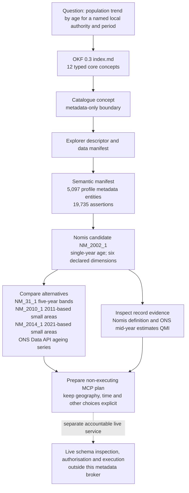

# OKF 0.3 complex question walkthrough: population by age

This guide is the metadata-backed question. The distinct
[core-only walkthrough](okf-03-core-only-walkthrough.md) asks what the 12
typed Markdown concepts establish about scope, freshness and conformance; it
does not reuse the dataset records, metadata graph or MCP plan described here.

## Question

> I need a population trend by age for a named local authority and a stated
> period. Which ONS dataset and edition should I consider? What nearby series
> could be confused with it? Which geography vintage, provenance and quality
> evidence can I inspect, and what must be chosen before a live query is
> authorised?

The walkthrough starts with one concrete candidate from the frozen metadata:
Nomis `NM_2002_1`, *Population estimates - local authority based by single year
of age*. It does not select an authority, age band, sex, measure or year on the
reader's behalf.

For the visual, see the [standalone HTML walkthrough](ons-population-by-age-walkthrough.html)
and [SVG flow diagram](ons-population-by-age-walkthrough.svg). The
[portable Explorer journey manifest](../evaluation/okf-03/ons-population-by-age-explorer-journeys.json)
drives the local browser run; the
[machine-readable source trail](../evaluation/okf-03/ons-population-by-age-source-trail.json)
binds its evidence and limits.

The producer build copies the HTML, diagram, journey manifest and source trail
into the public bundle before calculating checksums. The landing page links
to `walkthrough.html`. Public source citations use the exact retained repository
revision; local checkout paths are not used as deployed source links. The Pages
workflow requires these assets before upload, and the bundle check retrieves
their complete bytes along with every declared graph and core source file.

## Reader journey

The Explorer graph is a profile extension over the portable Markdown core. The
12 generated typed Markdown concepts are the OKF core concepts; the 5,097
source-backed metadata records are profile entities, not additional OKF
Markdown concepts. `index.md` and nested `index.md`/`log.md` files are
navigation only. The semantic and runtime entity identifiers remain unchanged
by the 0.3 migration. The HTML and SVG walkthrough present the source trail
and declared graph routes; they are not browser screenshots. In
the current Explorer canvas, the selected Nomis record opens with its immediate
publisher, format, topic, licence, tag and source-resource links. The three
inferred alternatives are not nodes in that initial canvas view; the Explorer
surfaces them as separate suggestions, while their full assertion evidence is
available in the semantic shards described below.

## What the evidence supports

### Example answer grounded in the frozen source

For a local-authority trend by single year of age, I would start by checking
Nomis `NM_2002_1`, *Population estimates - local authority based by single
year of age*. Its frozen record describes mid-year estimates at local-authority
level and above and lists age, frequency, gender, geography, measure and time
dimensions. It was first released on 11 August 2010 and revised on 30 July
2025. The record does not state its geography vintage, so I cannot recommend a
specific edition or confirm coverage for your requested period from this
snapshot alone. [The record definition and fields](../source/demo-snapshot/nomis-dataset-definitions.json#L128297)
and [its quality and methods statement](../source/demo-snapshot/nomis-dataset-definitions.json#L128185)
are the evidence for that starting point; the record cites the [ONS mid-year
population estimates QMI](https://www.ons.gov.uk/peoplepopulationandcommunity/populationestimates/methodologies/midyearpopulationestimatesqmi).

Before treating it as suitable, distinguish it from `NM_31_1` (five-year age
bands) and the 2011-based and 2021-based small-area series `NM_2010_1` and
`NM_2014_1`. Those are discovery alternatives, not equivalent substitutes.
The source snapshot does not settle the requested authority code, geography
vintage, age selection, sex, measure, frequency or period. Those choices and
the current live options need checking against the service before a query can
be authorised; this answer does not claim that a query was run.

The frozen Nomis record describes mid-year population estimates at local
authority level and above. It lists single-year age, frequency, gender,
geography, measures and time dimensions. Its metadata records a first release
of 11 August 2010 and a revision of 30 July 2025, links to an ONS mid-year
population estimates quality and methods information page, and has no separate
methodology link. The source metadata does not state a geography vintage for
this record. A reader must leave that point unresolved until the relevant
edition and geography codes are checked.

The source also documents estimates rebased to the 2021/2022 censuses, says
these replace earlier estimates for 2011–2022, and warns against interpreting
unrounded estimates as accurate to every displayed digit. Those statements
come from the Nomis source record; they do not establish that any particular
geography or requested time range is available in the current live service.

The nearby choices are not interchangeable:

- `NM_31_1` is a five-year age-band series. The frozen comparison evidence
  shows a different age grain and no quality-documentation flag.
- `NM_2010_1` is labelled as 2011-based small-area estimates for England and
  Wales.
- `NM_2014_1` is labelled as 2021-based small-area estimates for England and
  Wales.
- `ageing-population-estimates` is on the ONS Data API surface and is described
  as local-authority ageing statistics based on annual mid-year estimates. Its
  source, release and frequency metadata differ from the Nomis candidate.

The comparison edges are explicitly inferred discovery aids. Their similarity
scores and shared terms do not prove identity, equivalence or suitability. The
source record and these limits can be inspected in the frozen
[Nomis dataset definitions](../source/demo-snapshot/nomis-dataset-definitions.json#L128297),
including the record title and source definition at lines 128297–128303 and the
quality-method statement at [line 128185](../source/demo-snapshot/nomis-dataset-definitions.json#L128185).
The candidate cites the [ONS mid-year population estimates QMI](https://www.ons.gov.uk/peoplepopulationandcommunity/populationandmigration/populationestimates/methodologies/midyearpopulationestimatesqmi)
as a source; this walkthrough records that citation and does not independently
validate the live page.

## Graph and AI access

For the built candidate, the repeatable graph path is:

1. `index.md` → `concepts/catalogue.md` → `okf-explorer.json`.
2. `okf-explorer.json` → `data/manifest.json` →
   `data/semantic/manifest.json`.
3. Resolve the candidate route in the manifest-bound entity shards, then follow
   the alternative assertions in the manifest-bound assertion shards. For
   example, the inferred edge from `dataset/nomis-dataset-nm-2002-1` to
   `dataset/nomis-dataset-nm-31-1` has assertion IRI
   `https://chris-page-gov.github.io/okf-ons/assertion/1b7f034fd8099eaf3d51d314f63a170742474ec79781b97a883b278992bd44db`.
   Its predicate is `discoveryAlternative`, its derivation is the deterministic
   title/topic similarity rule, and the edge is marked discovery-only with
   statistical equivalence false.
4. The local MCP broker can replay `okf.search`, `okf.get_record`,
   `okf.compare` and `okf.prepare_mcp_plan` against the same frozen snapshot.
   The saved private replay receipt records snapshot ID
   `monday-2026-07-17-r2`, eight search candidates, the five-record comparison,
   six unresolved dimension choices and the non-executing plan. No network
   call or observation value was used.

The plan is not a live query. It remains unauthorised, non-executable and
unexecuted. Before a separate live service could act, a person or authorised
system would need to confirm the dataset edition, geography code and vintage,
age, sex, measure, frequency and period against that service's live schema,
then provide the required purpose and authority. The frozen record does not
contain those live option lists.

The v0.3 core and deterministic candidate source/import checks do not establish
live Pages availability, generic third-party AI-client compatibility, answer
quality or statistical accuracy. Those require separate exact-revision browser,
client and domain acceptance.

## Required publication gate

The existing protected `build` check now imports the generated Markdown with
the pinned independent Explorer Reader, checks all 12 concepts against the
portable projection, and replays all five journeys in Chromium. It checks full
frontmatter, bodies, source hashes and core reference pairs, and retains the
HTTP, parity and browser receipts. Failure prevents Pages deployment; the
bundle is built once and the same workspace is uploaded after acceptance.
Both the landing page and walkthrough declare an empty favicon, keeping the
journey free of an unrelated host-level request.

The complete public landing page, application JavaScript, stylesheet and
HTML guides are also build inputs. The compiler copies them and writes the
no-Jekyll marker before calculating checksums. No Pages overlay follows the
HTTP or browser gate, so the standalone archive and deployed candidate have
the same complete file inventory.
